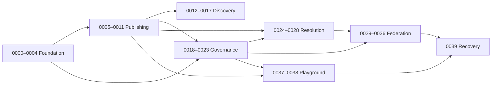

# Specification dependency model

`.gozleme/spec-registry.yaml` is authoritative for individual prerequisite edges; validate the DAG with `python3 scripts/validate_docs.py`. Phase order is an implementation recommendation, not a substitute for edges. Each spec is a vertical slice with its own demo. Only **human-merged** work counts as present on protected `main`.

